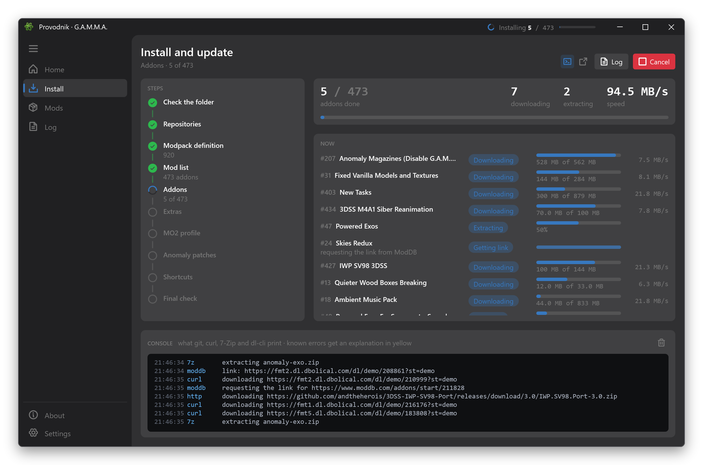
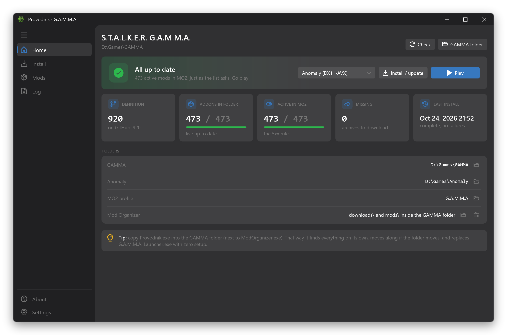
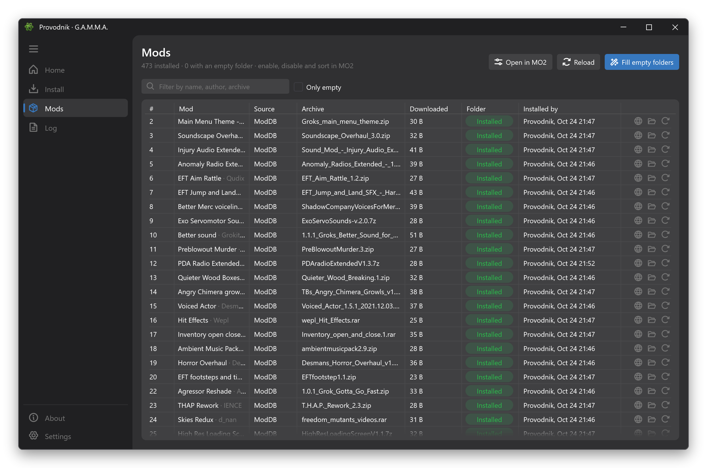

<p align="center">
  
</p>

<h1 align="center">Provodnik</h1>

<p align="center">
  A faster, sturdier installer and launcher for <b>S.T.A.L.K.E.R. G.A.M.M.A.</b>
</p>

<p align="center">
  <a href="https://github.com/ruan-luidy/Provodnik/releases/latest"></a>
  <a href="https://github.com/ruan-luidy/Provodnik/releases"></a>
  
  
</p>

<p align="center">
  English · <a href="docs/README.pt-BR.md">Português</a> · the app also speaks Русский
</p>



Provodnik (*Проводник*, "guide" in Russian) installs and updates the exact same G.A.M.M.A. you get from the official
launcher: same mod list, same folders, same MO2 profile. It just does it faster, and it doesn't leave you guessing when
something goes wrong.

> **Not an official G.A.M.M.A. tool.** The modpack, the mod list and the original launcher belong to Grok and the GAMMA
> team. Provodnik reads and writes the same files, so you can switch back and forth between the two.

## Why

|  | Official launcher | Provodnik |
|---|---|---|
| Downloads | one at a time | in parallel, resumed where they stopped |
| ModDB | the downloader now fails with "Failed to generate download link" | goes through a real browser engine (WebView2), paced so Cloudflare stays calm |
| Updates | re-extracts every addon | only re-extracts what changed |
| Interrupted install | you find out later | run it again and it picks up where it stopped |
| Empty mod folders | silent | detected, with one click to fix them |
| Errors | raw tool output in a console | the same console, with each known error explained and what to do about it |
| Before installing | — | checks permissions, disk space, antivirus, long paths, MO2 and the game being closed |

It also checks the result the way the community does by eye (every mod GAMMA enables in MO2 must actually have files),
and fixes a typo in GAMMA's own mod list that leaves one mod disabled for everybody.



## Install

No installer. One file:

1. Download **`Provodnik.exe`** from the [latest release](https://github.com/ruan-luidy/Provodnik/releases/latest).
2. Drop it in your GAMMA folder, next to `ModOrganizer.exe`.
3. Run it and press **Install / update**. Right-click → *Send to → Desktop* if you want a shortcut.

It finds everything on its own, uses the tools GAMMA already ships, and keeps itself up to date: new versions download
in the background and swap in when you close it (or right away with **Restart now**).

Windows 10/11 x64, everything bundled. A first install downloads around 45 GB and needs about 200 GB of free space
(the extracted mods alone are about 150 GB); after that, updates only fetch what changed. A full install from
scratch took about 35 minutes here.

## Mods screen



Every addon with its archive and folder, a filter, "only empty" and one click to redo a single mod. Enabling,
disabling and ordering mods is still MO2's job: **Play** opens MO2 straight into the executable you pick
(DX11-AVX, DX11, DX9...).

## FAQ

**Can I use it on a GAMMA installed with the official launcher?** Yes. The first run checks everything and only fixes
what's wrong.

**Will it touch my own MO2 profiles or extra mods?** An install rewrites the `G.A.M.M.A` profile's mod list from
GAMMA's definition, exactly like the official launcher. Other profiles, and mods you added on top (other packs,
your own tweaks), are left alone. Keep your own setup in a copy of the profile.

**Something failed.** Press **Retry failed** on the Install screen first; most ModDB hiccups go away. If not, the
**Log** screen has every install, and `.Grok's Modpack Installer\.provodnik\logs` has the files to attach to an
[issue](https://github.com/ruan-luidy/Provodnik/issues). Please report Provodnik problems here, not to the GAMMA
helpers: their support is for the official launcher, so check the problem there before asking on the GAMMA Discord.

## Build

```powershell
dotnet run --project src/Provodnik.Wpf -- --demo   # simulation: a fake GAMMA in %TEMP%, nothing is downloaded
dotnet test
python tools\build_tool.py --build --github        # tests, the single exe and the GitHub release
```

The code is split into `Provodnik.Core` (models and contracts, no dependencies), `Provodnik.Features` (the install
pipeline), `Provodnik.Infrastructure` (HTTP and the GAMMA tools) and `Provodnik.Wpf` (the UI). Translations live in
`Localization/*.{pt,en,ru}.json`; fixes and new languages are welcome.

## Credits

G.A.M.M.A. by Grok and the GAMMA team. Atom icon by [Icons8](https://icons8.com). Built with
[HandyControl](https://github.com/HandyOrg/HandyControl) and [Phosphor icons](https://phosphoricons.com).

## License

[MIT](LICENSE). G.A.M.M.A. itself and every addon it installs keep their own licenses.
