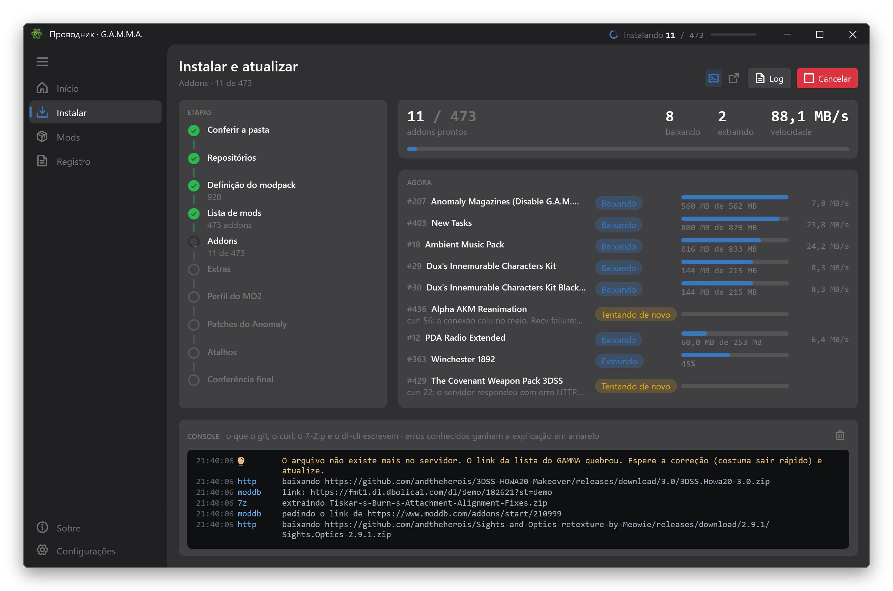
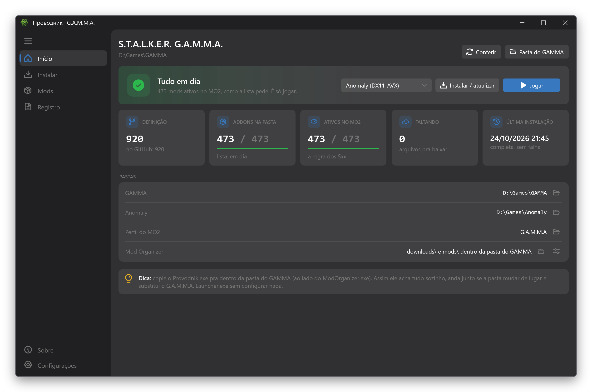
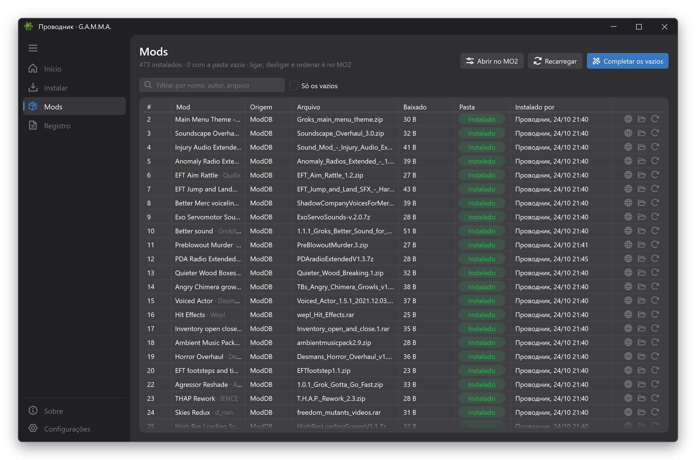

<p align="center">
  
</p>

<h1 align="center">Provodnik</h1>

<p align="center">
  Um instalador e launcher mais rápido e mais firme pro <b>S.T.A.L.K.E.R. G.A.M.M.A.</b>
</p>

<p align="center">
  <a href="../README.md">English</a> · Português · o app também fala Русский
</p>



O Provodnik (*Проводник*, "guia" em russo) instala e atualiza exatamente o mesmo G.A.M.M.A. do launcher oficial: a
mesma lista de mods, as mesmas pastas, o mesmo perfil do MO2. Só que mais rápido, e sem te deixar no escuro quando algo
dá errado.

> **Não é uma ferramenta oficial do G.A.M.M.A.** O modpack, a lista de mods e o launcher original são do Grok e da
> equipe do GAMMA. O Provodnik lê e escreve os mesmos arquivos, então dá pra alternar entre os dois.

## Por quê

|  | Launcher oficial | Provodnik |
|---|---|---|
| Downloads | um de cada vez | em paralelo, continuando de onde pararam |
| ModDB | o downloader agora falha com "Failed to generate download link" | passa por um navegador de verdade (WebView2), no ritmo que o Cloudflare aceita |
| Atualizações | reextrai todos os addons | só reextrai o que mudou |
| Instalação interrompida | você descobre depois | roda de novo e ele continua de onde parou |
| Pasta de mod vazia | passa calada | aparece, com um clique pra resolver |
| Seus mods | voltam desligados e misturados com os do GAMMA a cada atualização | continuam ligados, na sua ordem, num separador "Meus mods" |
| Erros | a saída crua das ferramentas no console | o mesmo console, com cada erro conhecido explicado e o que fazer |
| Antes de instalar | — | confere permissão, espaço, antivírus, caminhos longos, MO2 e jogo fechados |

Ele também confere o resultado do jeito que a comunidade faz de olho (todo mod que o GAMMA liga no MO2 precisa ter
arquivo) e corrige um erro de digitação na própria lista do GAMMA que deixa um mod desligado pra todo mundo.



## Instalar

Sem instalador. Um arquivo só:

1. Baixe o **`Provodnik.exe`** do [último release](https://github.com/ruan-luidy/Provodnik/releases/latest).
2. Jogue na pasta do GAMMA, ao lado do `ModOrganizer.exe`.
3. Abra e clique em **Instalar / atualizar**. Botão direito → *Enviar para → Área de trabalho* se quiser um atalho.

Ele acha tudo sozinho, usa as ferramentas que o GAMMA já traz e se mantém atualizado: a versão nova baixa sozinha e
entra quando você fecha o app (ou na hora, com **Reiniciar agora**).

Windows 10/11 x64, com tudo embutido. A primeira instalação baixa uns 45 GB e precisa de uns 200 GB livres (só os mods
extraídos dão uns 150 GB); depois, as atualizações só trazem o que mudou. Uma instalação do zero levou uns 35 minutos
aqui.

## Mods



Cada addon com o arquivo e a pasta, filtro, "só os vazios" e um clique pra refazer um mod só. Ligar, desligar e ordenar
continua sendo com o MO2: o **Jogar** abre o MO2 direto no executável escolhido (DX11-AVX, DX11, DX9...) e no perfil do
MO2 escolhido, quando você tem mais de um.

## Perguntas

**Funciona num GAMMA instalado pelo launcher oficial?** Sim. A primeira rodada confere tudo e só conserta o que está
errado.

**Mexe nos meus perfis do MO2 ou em mods que eu pus por cima?** Nos outros perfis, nunca. No perfil `G.A.M.M.A` a
atualização segue a lista nova do GAMMA, mas guarda o que você fez:

- os mods que você pôs ficam juntos, na sua ordem e ligados ou desligados como estavam, num separador "Meus mods" no
  fim da lista do MO2 (a prioridade mais alta, então eles ganham dos do GAMMA);
- mod do GAMMA que você ligou ou desligou continua assim, a não ser que o GAMMA tenha mudado esse mesmo mod;
- mod do GAMMA que você trocou pela sua versão pelo MO2 fica com a sua (o **Reinstalar este mod** da tela Mods volta
  pra do GAMMA).

Uma cópia do `modlist.txt` de antes vai pra `.Grok's Modpack Installer\.provodnik\profile-backups` (as 10 últimas).

**Algo falhou.** Primeiro o **Tentar de novo as falhas** na tela de instalação; a maioria dos soluços do ModDB passa. Se
não, o **Registro** tem todas as instalações, e em `.Grok's Modpack Installer\.provodnik\logs` estão os arquivos pra
anexar numa [issue](https://github.com/ruan-luidy/Provodnik/issues). Problema do Provodnik é aqui, não com os helpers do
GAMMA: o suporte deles é do launcher oficial, então confira o problema nele antes de pedir ajuda no Discord do GAMMA.

## Compilar

```powershell
dotnet run --project src/Provodnik.Wpf -- --demo   # simulação: GAMMA de mentira em %TEMP%, nada é baixado
dotnet test
python tools\build_tool.py --build --github        # testes, o exe único e o release no GitHub
python tools\build_tool.py --gamma D:\GAMMA        # o exe único direto na pasta do GAMMA
```

O código se divide em `Provodnik.Core` (modelos e contratos, sem dependências), `Provodnik.Features` (o pipeline de
instalação), `Provodnik.Infrastructure` (HTTP e as ferramentas do GAMMA) e `Provodnik.Wpf` (a interface). As traduções
ficam em `Localization/*.{pt,en,ru}.json`.

## Créditos

G.A.M.M.A. do Grok e da equipe do GAMMA. Ícone do átomo do [Icons8](https://icons8.com). Feito com
[HandyControl](https://github.com/HandyOrg/HandyControl) e [Phosphor](https://phosphoricons.com).

## Licença

[MIT](../LICENSE). O G.A.M.M.A. e cada addon que ele instala seguem com as licenças deles.
